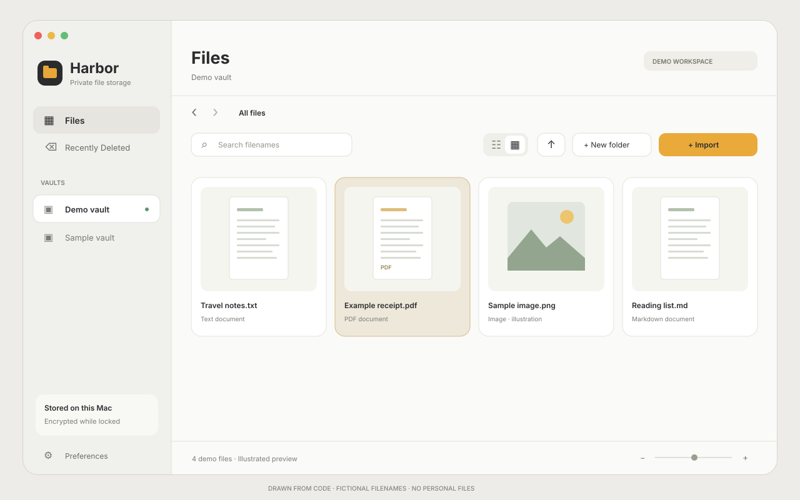

<p align="center">
  
</p>
<h1 align="center">Harbor Vault</h1>
<p align="center">A familiar place for private files. Encrypted vaults, right on your Mac.</p>
<p align="center">
  <a href="https://github.com/arjun1223/HarborVault/releases/latest"></a>
</p>
<p align="center">macOS 14+ · Apple silicon · Touch ID / Mac password · No account</p>



*Workspace illustration with fictional demo filenames, drawn from code. This is not a screenshot of a personal vault.*

## Download

**[Download Harbor Vault for Mac](https://github.com/arjun1223/HarborVault/releases/latest)** from the latest release. Open `HarborVault-1.2.0-macOS-arm64.dmg`, drag **Harbor Vault.app** into **Applications**, then eject the disk image and open the app.

The download supports **Apple silicon Macs running macOS 14 or newer**. Intel Macs are not supported by this build. The release includes `SHA256SUMS.txt` to verify the DMG download.

This is an early public build, **ad-hoc signed and not Apple-notarized**. macOS may block it because Apple cannot verify its developer. A Developer ID signed, notarized download is not available yet. See [Apple’s guidance for opening an app from an unidentified developer](https://support.apple.com/102445).

## What Harbor Vault does

| Feature | What you get |
| --- | --- |
| Separate vaults | Independent encryption keys, names, and passcodes for each vault |
| Mac authentication | Optional Touch ID / Mac login password, or a vault’s own passcode |
| Familiar browsing | List and grid views, folders, filename search, back/forward navigation |
| Selection | Shift/Command selection, keyboard navigation, and drag-to-select rectangles |
| Previews | Space for a small preview; double-click for a separate viewer with a selected-file sidebar |
| Image and PDF zoom | Two-finger pinch, zoom buttons, Fit, and panning |
| Private viewer | Leaving the full viewer locks that window; closing previews keeps the vault open |
| Verified import | Encrypt and verify a copy before offering to move Finder originals to Trash |
| Recently Deleted | Per-vault recovery, adjustable retention, individual deletion dates, and restore locations |
| Vault transfers | Move one copy or duplicate into another vault after destination verification |
| Sharing | Fresh verification before the native AirDrop, Messages, or other Mac sharing picker |
| Preferences | Light/dark/system appearance, text size, thumbnail size, and density |

Images, PDFs, and small UTF-8 text have in-app previews. Other file types can be stored, browsed together, shared, and exported; they display file information when an in-app preview is unavailable. Preview input is limited to 50 MB and text display to 2 MB.

## First-time setup

1. Open Harbor Vault and create a vault with its own passcode of at least 10 characters.
2. Leave **Also unlock with Touch ID / Mac password** enabled if you want Mac authentication as an alternative. Disable it to require that vault’s passcode.
3. Import disposable test files or drag them from Finder. Keep the originals while trying the app.
4. After a verified import, choose **Keep originals** or **Move originals to Trash**. Finder Trash remains separate from the vault’s Recently Deleted.
5. Use **Lock** (⌘L) when finished. Normal idle, sleep, and screen locking also apply.

A vault passcode cannot be reset without an existing unlocked session. Keep a separate backup of irreplaceable files. See the [full user guide](docs/USER_GUIDE.md) for recovery, sharing, vault transfers, passcode changes, and backups.

## Your data stays on your Mac

Harbor Vault has no account, analytics, cloud service, or runtime networking. Vault contents and file metadata are encrypted locally. Separate vaults have independent random keys; passcodes wrap those keys, with optional hardware-backed Mac authentication.

Vault names remain visible while locked. Encrypted file sizes, counts, and filesystem timestamps remain observable. Exports and shares deliberately create readable copies outside the vault’s protection; another app or recipient may retain those copies. Deleting files does not erase outside copies, backups, or filesystem snapshots.

**This app has not received an independent security audit.** It protects files at rest while locked; it does not protect against malware, privileged access to your Mac, screen capture, or someone viewing an unlocked vault. See [storage details and security boundaries](docs/USER_GUIDE.md#storage-and-implementation).

The public repository and release contain app code, build tools, documentation, generated artwork, fonts, and licenses. They contain no personal vaults, imported photos, credentials, exports, or runtime history. The artwork uses fictional demo names.

## Build from source

Install the full Xcode application, then:

```sh
git clone https://github.com/arjun1223/HarborVault.git
cd HarborVault
bash build.sh
```

The app is written to `output/Harbor Vault.app`. No third-party packages, API keys, or accounts are required. Font assets and their licenses are bundled locally. The scripts default to Xcode at `/Applications/Xcode.app/Contents/Developer`; set `DEVELOPER_DIR` if yours is elsewhere.

Run the generated-fixture checks with `bash test.sh`. The 1.2.0 release source passed **190 automated checks**. Release assembly is documented in [RELEASING.md](RELEASING.md).

## Updates and feedback

Download updates from [Releases](https://github.com/arjun1223/HarborVault/releases). To report a bug, [open an issue](https://github.com/arjun1223/HarborVault/issues/new) with your macOS version, app version, and steps to reproduce using disposable files. Never post vault storage, passcodes, private photos, or sensitive screenshots publicly.

Unlike a release download, GitHub’s automatic source archives contain the project source. Use the named **macOS DMG** to install the app. See [CHANGELOG.md](CHANGELOG.md) for release history.
